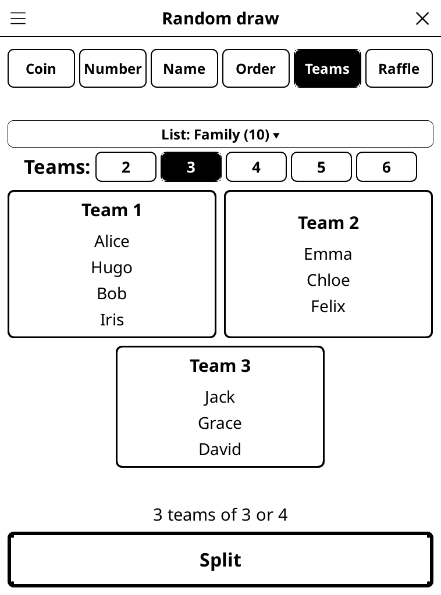

# randomizer.koplugin

**Random draw** (FR « Tirage au sort ») for [KOReader](https://github.com/koreader/koreader) — the e-reader decides, fairly, for everyone around the table: lay it in the middle or pass it round.

## Screenshot



## Draws

- **Coin** — heads or tails in big letters, with the last flips and the count of each side.
- **Number** — a whole number between two bounds (both included, negatives allowed), typed on a big keypad, or a preset: 1–6, 1–10, 1–20, 1–100, 0–9.
- **Name** — one name picked from a list.
- **Order** — the whole list shuffled: who plays first, second… (turn order).
- **Teams** — the list split into 2 to 6 teams whose sizes differ by one at most.
- **Raffle** — names drawn one by one without putting them back, until the list is empty; Start over puts them all back. A name written twice has two tickets.

## Features

- Saved lists of names (family, class, club…): create, edit (one name per line), rename, delete; switch list from the button above the result.
- The players remembered by **Score sheets** can be imported as a list (read from its settings file; the two plugins work without each other).
- Large, high-contrast results, readable from across the table; the draw button is big and stays in the same place.
- A raffle in progress, the last results and the history are kept when the screen is closed.
- Randomness: `math.random` seeded each time the screen opens from `/dev/urandom` (when the device has it, as Kobo and Kindle do), the time and the CPU clock — another game seeding a fixed value (a daily challenge) never makes the draws predictable; shuffles are Fisher–Yates, teams are dealt round-robin from a shuffle.
- Rules in English and French (☰ → Rules); interface in English, French, Spanish and German.

## Development

`rng.lua` holds the draws, `lists.lua` the saved lists (pure Lua, no UI), `numentry.lua`/`numpad.lua` the keypad (same files as Score sheets, vendored), `screen.lua` the screen. `test_rng_spec.lua` covers ranges, bias (chi-square), shuffles, team sizes, the raffle, lists and the keypad entry.

```
busted test_rng_spec.lua
```

## License

GPL-3.0
